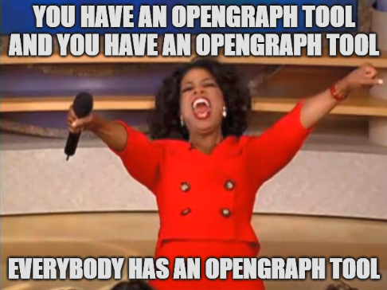
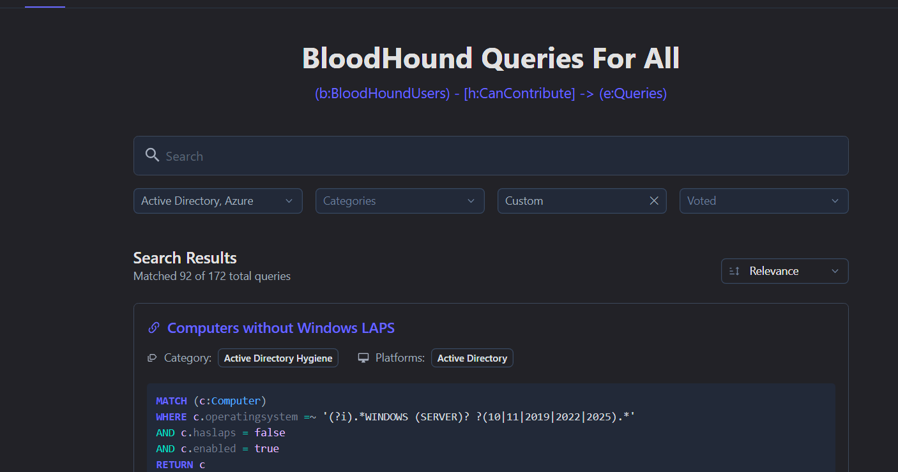
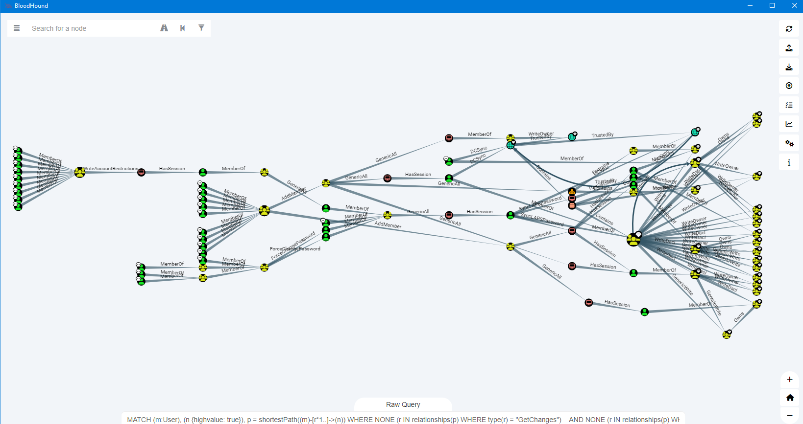
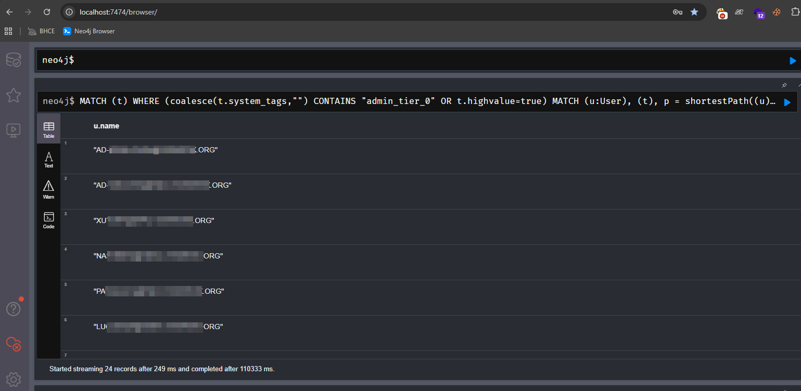
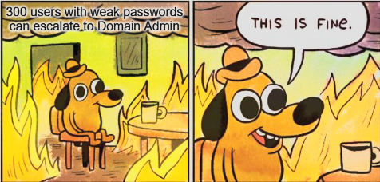
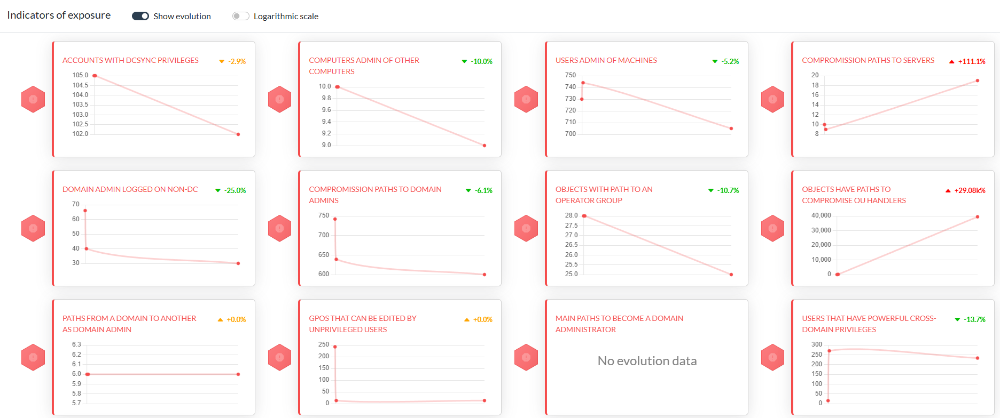
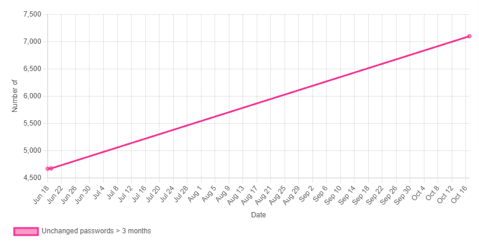
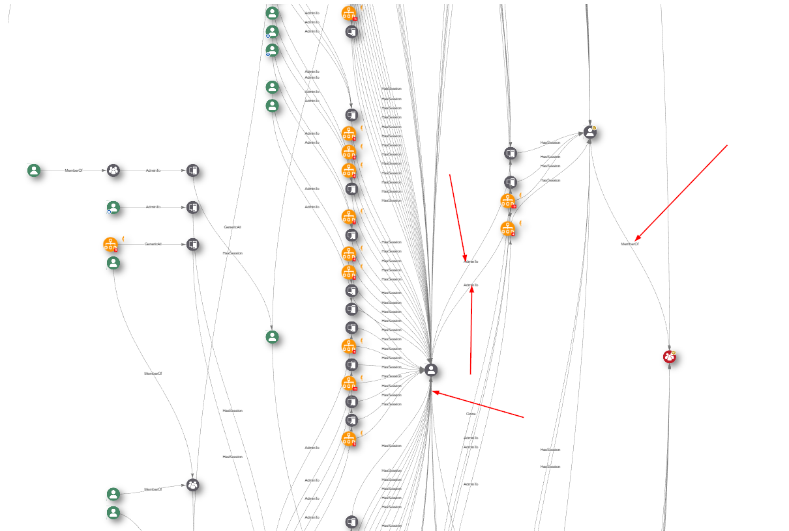

Today I am going to show you how to put the doggo to use for some edgecases and how I tackled certain scenarios and got him help me.    
We will do stuff like enriching session data, extending visibility and aiding with password audits to make them more awesome.  
So get seated, grab some popcorn and lets go.

  

<!--more-->
# Introduction  

BloodHound was and will always be my goto-tool when it comes to auditing AD environments.  
Over the last months I expanded the capabilites of the tool and implemented it in aiding with repeating tasks more and more and want to share my thoughtprocess here, how I tackled stuff etc. ...  
Maybe some of this can be an inpsiration to you as well.   
I know right now everyone is riding the OpenGraph wave (and that for good reason), but you are not going to find this stuff within this blog post.

  

# Why, What, Who ...

The doggo always was my sidekick and a valuable resource to quickly answer questions like: 
"How many DAs do we have?"  
"Can you show if X has any impact?"  
"Is the offboarding process working?"  
...

And it was always only about to either get some of the already available (build-in) queries or write some cypher shit on the fly.

Having those info at hand I wanted to see what other / additional benefits I could squeeze out of it or into it.  
As you might already know, I have my own [repo](https://github.com/LuemmelSec/Custom-BloodHound-Queries) of custom queries where I just dump everything I come up with, either while tackling daily tasks or while going through some lab or training scenarios. Most of them are Cloud related, an area where the default BH still falls short somehow. And while some of the queries in there made it into the default for BloodHound, a lot of them did not. In the meantime [Martin](https://www.linkedin.com/in/martinsohn) and the Specters came up with a centralized approach of BloodHound queries. Much more organized and thought through than my lousy approach, so give it a shot.  

The next thing I used it for was enhancing password audits. Normally you have a list of users with weak passwords. If you use something like [pwdumpstats](https://github.com/dionach/pwdumpstats) you might also have info about high priv accounts with weak passwords, re-used passwords and some nice statistics.    
To me, it more was a question of: Which users with shitty passwords had EASY escalation paths so we can prioritize them, hopefully resulting in a much smaller group of users we have to work on.

  

What also drove me nuts lately was the absence of session data. And unfortunately a lot of real world attack paths rely on exactly this kind of info: Your user can RDP to X where Domain Admin A has a session. Go fetch his creds. With the shortcomings of not being able to collect session data as low privileged user on newer operating systems and the fact that with Home-Office a lot of client machines simply no longer are reachable if we internally collect session data, it would be nice to somehow compensate this.

Last but not least being able to track progress on remediation tasks and the evolution of new findings would be nice to hand out to management. With an addition of identifying choke points where we should focus on first to remediate the most impactful findings to begin with.

# Lets get dirty, shall we?

## Queries, queries, queries

In BloodHound it's all about what you ask it to hand out to you. The default stuff for OnPrem is really cool and you will find lots of additional repos with hundreds of usefull queries as well.  
Different story for the cloud part, where you mostly have queries that are unrelated to attack paths and will rather give you back collections of stuff, like show me all Global Admins etc.  
I mainly used ChatGPT in the past to help me build the stuff I wanted to see or fiddle around with existing ones until I got what I needed. Please feel free to also refer to my other blog post [https://luemmelsec.github.io/Fantastic-BloodHound-Queries-and-Where-to-Find-Them/](https://luemmelsec.github.io/Fantastic-BloodHound-Queries-and-Where-to-Find-Them/) if you want to have a deeper look.  
But there are also some newer developments hitting the market. Just to name two of them we have:  

[Mor David's](https://linkedin.com/in/mor-david-cyber) BloodHound MCP AI: [https://github.com/MorDavid/BloodHound-MCP-AI](https://github.com/MorDavid/BloodHound-MCP-AI). It's an MCP integration for Cypher queries and allows you to use your natural language to "ask" BH what you want to see. However, it also relies on the stuff that is built into it, so it won't create new queries for you, it just eases the way you can get the results of the ones defined.

The other tool is [https://queries.specterops.io](https://queries.specterops.io). A community driven repository of useful Cypher queries where you can do lots of filtering, free text search and more.  

 

And while I like the idea, I don't see much contributions to the list of queries, or maybe it already has everything there is to query... 
Now, with the introduction of OpenGraph into BH, it might face some new ups in the future if the Specters decide to extend it accordingly.


## Password, passwords, passwords

If we extend the tool with data and functionality, new doors open.  
At work we are doing regular audits of the password quality across all accounts. Back in the days when we sold password audits we would get a copy of the ntds.dit file or a mimikatz / secretsdump export and then run tools like pwdumpstats or similar against it.  
In the best case that would provide you with a nice overview of some key indicators related to password strength and distribution. Like, how many users have a weak password, how many passwords are re-used, which admin users had their password cracked, etc.  

However, this approach is missing crucial key points. What I am really interested in from an attacker's perspective is:  
Can we abuse one of those accounts with a weak password to move laterally or horizontally? Do they have escalation paths? Are they admin to a computer or even server?  
That is something we can get out of BloodHound, so let's combine the info.  
In my case we export a list of all cracked users after the password audit which looks like:  
```
user1@domain.forrest.com
user2@domain.forrest.com
user1@forrest.com
....
```
This info is then feeded into BloodHound. I am currently using either [Max](https://github.com/knavesec/Max) or [bhcli](https://github.com/exploide/bhcli) and it just looks like so:  

```
python max.py -u neo4j -p bloodhound --url http://127.0.0.1:7474 mark-owned -f cracked.txt --add-note "password cracked"
```

Next my workflow is about defining more relevant targets which I can query paths to. Most likely I am missing out on parts here, and everything could directly be done with one query. But feel free to develop your own approach. Here goes my version:  

Out of the box BH marks groups like ``Domain Admins`` as high value or ``tier_0``, which is absolutely cool.
However, if a group has an easy escalation path to on of the high value targets, I personally would also call this a high value group. This also allows to write cypher queries that can go further and are more performant.
For this reason, for BH Legacy I fetch all groups that have a path to the default ``highvalue`` groups WITHOUT the ``CanRDP`` edge (because this always involves privesc which not always is possible, is noisy, hard to achieve etc.) and mark them as ``highvalue``. 
For BHCE we also need to exclude several other edges, e.g. ``LocalToComputer``.

```
//Legacy via neo4j browser
MATCH (x:Group)
WHERE x.highvalue=true
MATCH p=shortestPath((n:Group)-[r*1..]->(x)) 
WHERE x <> n
AND NONE (r in relationships(p) WHERE type(r) = "CanRDP")
SET n.highvalue = true
RETURN n.name, n.highvalue
```

```
//CE neo4j browser
MATCH (x:Group)
WHERE (coalesce(x.system_tags,"") CONTAINS "admin_tier_0")
MATCH p=shortestPath((n:Group)-[r*1..]->(x)) 
WHERE x <> n
AND NONE (r in relationships(p) WHERE type(r) = "CanRDP")
AND NONE (r in relationships(p) WHERE type(r) = "LocalToComputer")
\\ANY MORE WE NEED TO EXCLUDE?
SET n.system_tags = "admin_tier_0"
RETURN n.name, n.system_tags
```

Next, we start combining the data and get the final results we want to see:  

Users with weak passwords and path to highvalue targets  
```
//BloodHound Legacy & CE
MATCH (t)
WHERE (coalesce(t.system_tags,"") CONTAINS "admin_tier_0" OR t.highvalue=true)
MATCH (u:User), (t), p = shortestPath((u)-[r*1..]->(t))
WHERE NONE (r IN relationships(p) WHERE type(r) = "GetChanges") 
  AND NONE (r IN relationships(p) WHERE type(r) = "GetChangesAll")
  AND NONE (r IN relationships(p) WHERE type(r) = "CanRDP")
  AND NONE (r in relationships(p) WHERE type(r) = "LocalToComputer")
  AND NOT u = t
  AND toLower(u.notes) = toLower("password cracked")
  AND u.enabled = true
RETURN p
```
Here's how that might look as a result:  

 

and users as a list:  
```
//neo4j browser
MATCH (t)
WHERE (coalesce(t.system_tags,"") CONTAINS "admin_tier_0" OR t.highvalue=true)
MATCH (u:User), (t), p = shortestPath((u)-[r*1..]->(t))
WHERE NONE (r IN relationships(p) WHERE type(r) = "GetChanges") 
  AND NONE (r IN relationships(p) WHERE type(r) = "GetChangesAll")
  AND NONE (r IN relationships(p) WHERE type(r) = "CanRDP")
  AND NONE (r in relationships(p) WHERE type(r) = "LocalToComputer")
  AND NOT u = t
  AND toLower(u.notes) = toLower("password cracked")
  AND u.enabled = true
RETURN DISTINCT u.name
```

 
From here you can just export the list of users as csv and then attach it to your ticket, task or whatever.  

Users with weak passwords that are admin to a system

```
//BloodHound Legacy
MATCH p=(m:User)-[r:AdminTo]->(n:Computer) 
WHERE m.notes = 'password cracked'
AND m.enabled = true 
RETURN p
```

```
//neo4j browser
MATCH p=(m:User)-[r:AdminTo]->(n:Computer) 
WHERE m.notes = 'password cracked'
AND m.enabled = true 
RETURN DISTINCT (m.name)
```

This data finally lets us focus on so called choke points. We don't need to go after hundreds or even thousands of users but rather focus on (hopefully) the few that would have a real impact in case of compromise.  

 

## Sessions, sessions, sessions

If you are in the pentest game for a while you might still remember the good old days when after SharpHound ran you would be greeted by a wealth of session data, which a lot of the escalation paths actually rely on.

 

The tables have turned since then. Nowadays a lot of factors come together that will give you way less session data. Things like needing admin rights to query the info, people working purely in the cloud so you can't reach their systems with an internal scan etc. pp.  

Fortunately there are some geniuses out there that found different ways for enrichtments by ingesting data from other sources that holds this info.  
First and foremost there is [FalconHound](https://github.com/FalconForceTeam/FalconHound). If you are on the blue side I can absolutely recommend it. It provides the ability to query Defender data which knows everything about who is logged in where, and push that data into your neo4j database. It will also give you information about who ``had`` a session in the past, so maybe he will come back in the future. You can also attach other sources to it like Splunk or even extend it with your own source. The last cool bit about it is that it allows you to also push data into the other direction e.g. Sentinel, to create alerts there if new attack paths pop up and even link the according queries to your BloodHound into it. Very fancy, but also need an experienced SOC that is capable of working with this info.  

Next up we have [SCCMHound](https://github.com/CrowdStrike/sccmhound) which, as the name suggests, extracts the session data out of an SCCM database.  
Yes, these tools only have limited use in a pentest / Red Team engagement, but they are an absolute gamechanger for enrichtment.

## Progress, progress, progress and choke points

This is about the tool [AD Miner](https://github.com/AD-Security/AD_Miner).  
I love it for 2 reasons.  
The first one being to have the ability to see the progress you have made over time to mitigate certain attack paths and also about some general metrics. If you lets say run AD Miner every month, your will get a lovely track record of all the stuff it ingests and can use that e.g. to present to management, rate progress of your infra team or whatever.  

  

 

What I love even more is the ability to identify choke points for certain attack paths. If you ever had a call or talk with the Specters about BloodHound, you will be familiar with this term.   If we for example look at user to DA escalation paths, we can clearly see where we potentially could make a cut and get rid of all the attack paths behind it. Let me give you a picture to clarify more on that:  

 

Ofcourse this needs to be though through, but you have the visibility and a foundational basis to identify these choke points and take actions on them.  

Additionally the team around AD Miner also started to implement the first parts around Azure attacks paths, but this still is in development. However, you should still go for it. Something is better than nothing.

# Wrap up

Yeah there goes. My little yourney finally came to an end. It was more thinking and tinkering than actually doing as I had to wrap my head around different concepts, tools and situations.  
What I wanted to make clear is that existing tools can be extended and data connected to get even more benefit out of them, BloodHound being just one example out of a whole lot.  

Stay safe and happy sniffing.  
LuemmelSec
