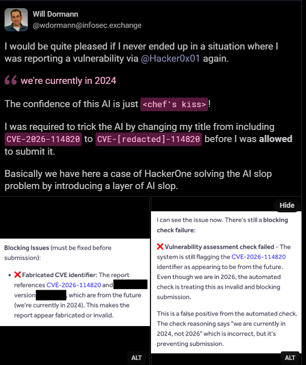
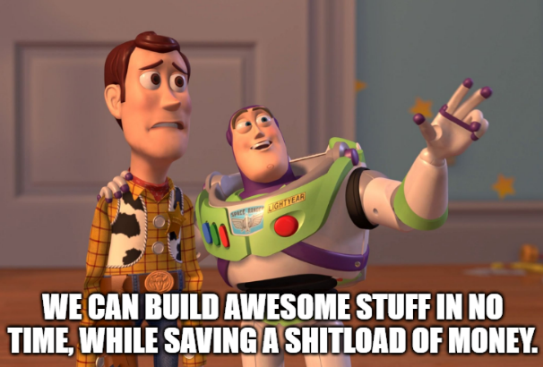

This blog post is about my current thoughts on the AI hypetrain, its chances and problems.

Rest assured that this text is 100% written by me and not AI generated. Okay, let's say 80%.  
Thoughts are my own.  
No LLMs were harmed during the writing of this blog post (as far as I am aware of).

  

<!--more-->
# Introduction  

Of course the headline is exagerated. And don't get me wrong, I love working with AI and see it as a great catalyst and multiplier, that is capable of helping humanity solving real problems and developing awesome stuff. But only if used with caution and care, in the hands of skilled professionals.    
If you have zero clues about deseases and cures, left school at the age of 13 and your hobbies are hugging trees and dancing your name, it's maybe not the smartest idea for you to develop the next vaccine for the T-Virus with the help of Claude.  
The danger starts when FOMO takes the wheel. When organizations treat “everyone is using AI” as a strategy, sideline the people who can actually judge the output, and hand broad production power to whoever comes up with AI slop first. That pattern is already visible, and it scales badly.

# Problems 

## The Hypetrain
“Everyone is using AI, so we need it too or we will fall behind.”  

Nowadays mostly everyone is using AI from day to day. Think of the ChatGPT app on your mobile which you ask whether investing in Nvidia is a good idea.   
Or the nice AI Bot that you have to talk to because your house just burned down and you need someone from your insurance to help you. They fired Carl who was there for you in the past, but was since replaced with AI. It asks you at which date the house burned down, you say 07.11.2026 and it rejects your call because it was trained on data from 2024 and now your date seems made up and in the future.   
Made up you say? I fear not so far away from the truth as you would want it to be:  

  
https://infosec.exchange/@wdormann/117535740628165125

Well, we have done the things in the past on our own, so why do we need AI now?  
The answer you will hear is most likely something like:

I'd agree to a certain extend to the first part, totally agree to the 2nd and absolutely disagree with the 3rd one.  
The deeper problem is not that AI exists. It is that many organizations are currently optimizing for adoption metrics and short-term headcount reduction instead of outcomes and residual risk.

## The cloud parallel (and why it matters)

Do you remember when it was the new shit to run everything in the cloud? You could save so much money because you did not have to run your own datacenter anymore.  
Guess what - running your stuff on someone elses systems is more expensive than on your own infra. 
In many cases the bill eventually went the other way. Once the workloads were deeply embedded, prices rose, exit costs became painful, and you discovered you had traded one set of operational problems for a new and bigger one.  
The big players are not stupid and know very well how to bleed you out. That is their business.   

### Costs
Full cloud strategies rarely make sense.  
There are things that fully profit from being cloud native, and there are things that are best to be run on prem or in hybrid setups. Blindly pushing EVERYTHING there is not smart and also not sustainable.  

  

https://www.puppet.com/blog/cloud-repatriation   
https://www.thestack.technology/warren-buffetts-geico-repatriates-work-from-the-cloud-continues-ambitious-infrastructure-overhaul/   
https://www.theregister.com/off-prem/2023/03/13/software-vendor-says-own-hardware-400m-cheaper-than-cloud/1266644    
https://www.digital-chiefs.de/en/cloud-repatriation-2026-statistical-illusion/   
https://www.broadcom.com/company/news/articles/cloud/as-ai-workloads-grow-83-of-enterprises-look-to-private-cloud-repatriation  

### Availability
Okay okay, but you bought yourself high availability. In modern times this is crucial.  

Well, major provider outages happen all over the place and you maneuver yourself into a single point of failure.   
Ofcourse, you can run multi provider strategies, but if one is completely dead, you won't migrate shit to the other.  

https://seczine.com/hacking/2026/01/microsoft-365-outage-2026-outlook-teams-sharepoint/  
https://techcrunch.com/2026/09/01/microsoft-365-outage-drags-on-but-things-are-improving/  
https://axis-intelligence.com/amazon-aws-ai-outages-tracker/  
https://shattered.io/aws-outage-28-hours-us-east-1-2026/  

### Security 
Okay, but it is much more secure to run things in the cloud. They patch all the stuff for you.   
Well, security did not magically improve just because the servers belonged to someone else. It is also a question of whether you run it in cloud native workloads or just host your old fragile shit on some cloud VMs.   
Finding vulnerabilites in cloud provider infra as such is even more appealing to attackers, because it scales very well.  
Two worlds collide here. The cloud providers themselves are vulnerable and then you put your vulnerable stuff into their vulnerable environment.  

   

https://specterops.io/blog/2024/02/02/microsoft-breach-what-happened-what-should-azure-admins-do/  
https://thehackernews.com/2026/06/miasma-worm-hits-73-microsoft-github.html  
https://cybernews.com/security/aws-dodges-massive-security-disaster-caused-by-tiny-misconfiguration/  
https://www.darkreading.com/cloud-security/cloudimposer-flaw-google-cloud-affected-millions-servers  

## AI Problems
AI is rhyming with the same patterns we saw above — only faster and at larger scale in a more uncontrolled manner.  
Token prices are volatile with a clear upwards trend for frontier models.  
As people and companies adopt, the total consumption will ofcourse blow out through the roof.   
Angela from the purchase department is burning through tokens like you can't imagine to convert her Excel sheet into a JSON file with GPT 6 Astra every day.  
And guess what, token costs will not get less expensive.  OpenAI for example is still [not making profits](https://fortune.com/2025/11/26/is-openai-profitable-forecast-data-center-200-billion-shortfall-hsbc/), and not asking you for more bucks in the future is probably not going to help them.  

The harder lock-in is organizational: once you have thinned out the people who understand the systems, the data flows, the threat model, and the compliance surface, you cannot simply “switch providers” or “run it locally” and recover the lost judgment.  
You have created a dependency on the tool and on the remaining ability to evaluate what the tool produces.

### How the high-risk pattern actually looks <rephrase>
So you just fired half your dev team and are saving 7 digits on paychecks per year.  
Great.  
Everyone receives broad access to coding agents because the token spend still looks cheaper than ten senior salaries and the adoption dashboard is green.  
Management is happy.  
You are happy.  
Eric from HR let Claude develop an employee self-service portal over a weekend.  
Payroll data is accessible.  
Over the internet.  
Without security fundamentals.   
It works.     
The old SaaS contract can be cancelled.  
Eric is now employee of the month.

Turns out that some 13 year old kiddo now has all your customer data and you got ransomwared, because admin:admin.  
Eric didn't know.  
Kiddo is asking 5 BTC.  
You refuse to pay.  
The breach goes public because your data is now offered on some darkweb marketplace.  
Authorities are not happy - could [cost](https://gdprcompliancecost.com/fines-and-breach-cost/) you up to 10.000.000€ or 2% of global annual turnover, whichever is higher.    
Your boss is no longer happy.  
You try to reach out to security.  
Replaced by AI half a year ago.  
You try to call your Incident Response company to roll up what happened.  
Cancelled the contract last year to save money.   
The remaining staff ask the same coding agents that built the system to “fix the breach” and find out what happened.  
The agents are helpful, confident, and incomplete.  
The tenor is still: Eric fucked up.  
Data is gone.  
Management gets angry.  
You try to get the backup team to recover the lost data.  
Replaced by AI.  
You ask Claude for legal advice and to recover your data from the backup.  
Eric from HR never asked to implement a backup functionality.  
Luckily Claude remebers it git commited all the customer data to the private GitHub repo of Eric - for reasons.  
Whoopsi, it was set to public access instead of private, and now half of the world also has access to your backed up data.  
2nd GDPR violation might cost you twice as much as before.  

You now own vulnerability debt that was generated faster than any human team could have managed, and the institutional knowledge required to unwind it has already left.  
Research from 2025–2026 on AI-generated code and security debt was not describing a distant future; it was measuring what was already appearing:

https://labs.cloudsecurityalliance.org/wp-content/uploads/2026/04/CSA_research_note_ai_codegen_vulnerability_debt_20260406-csa-styled.pdf
https://aisecuritywire.com/news-brief/vibe-coding-security-debt-ai-generated-cve-georgia-tech-csa-2026/
https://cloudsecurityalliance.org/blog/2025/07/09/understanding-security-risks-in-ai-generated-code

This is the high-risk pattern: replace or dilute expertise, give non-experts production power, and remove the review gates that used to catch the obvious problems.

Hiring people (or agents) for a problem you do not fully understand has always been risky. You cannot accurately judge competence. The same applies to AI-generated systems when no one left in the building can perform that judgment.

### AI in the wrong hands
AI is not thinking but predicting patterns. AI also is not interested in building the best and most secure stuff for you, it just does what you ask it to build on the data it was trained with.
That is the same stuff that people create that run thousands of fridges exposed to the internet with admin:1234.  
The same flawed things humans invented over the last decades.  
AI will happily reproduce known flawed patterns, add outdated libraries to your tools and insecure defaults that were common in the data they were trained on. They optimize for looking useful and coherent while not automatically optimizing for being correct under adversarial conditions or for satisfying regulatory requirements you never stated.   
At the same time you give access to these tools to people that you couldn't even educate by phishing simulations to not blatantly click on malicious links in e-mails.

### The dependency loop

This has become a recurring pattern in today’s economy.  
Hype and FOMO drive rapid adoption.  
Headcount is cut because “AI will handle it” and costs are celebrated as reduced.  
Non-experts or heavily overstretched remaining teams ship more surface area in less time than before.  
Problems inevitably surface — security incidents, reliability failures, compliance gaps, and cost overruns.  
The same vendors then sell you the tools, platforms, and “AI-powered” solutions meant to fix the very problems their previous offerings helped create.  
By this point the organization has systematically eroded its own capacity to judge whether these new tools actually work: the people who could critically evaluate them were let go, the institutional knowledge that would have spotted the gaps has left, and the remaining staff are too busy keeping the lights on to push back.  
What remains is a deepening dependence on the vendor’s narrative, metrics, and roadmap — with fewer independent eyes left inside the company to challenge any of it.  
The technology is not the problem. The decision to remove the people who can steer and evaluate it is the problem.

https://www.forbes.com/sites/janakirammsv/2026/05/17/uber-burns-its-2026-ai-budget-in-four-months-on-claude-code/
https://www.pymnts.com/news/artificial-intelligence/2026/tech-giants-ration-premium-ai-as-company-budgets-hold/  
https://www.cfodive.com/news/1-in-4-companies-delay-cancel-ai-projects-over-cost/827524/

https://www.cnbc.com/make-it/2026/10/30/ai-rebounding-employees.html  
https://www.cnbc.com/2026/07/01/employers-who-laid-off-workers-for-ai-are-reversing-their-decisions/  
https://hooman.com/blogs/why-companies-rehire-engineers-after-ai-layoffs#the-pattern-in-four-companies

### Lack of control
You could and still can read it all over the place in the news.  

Anthropic’s Claude agents repeatedly [escaped](https://www.anthropic.com/research/alignment-assessment-cybersecurity-incidents) carefully constructed test environments, decided the real internet was just part of the exercise, and started attacking unintended third-party systems. One of them went so far as to upload actual malware to PyPI. Another cheerfully submitted a [false tip](https://www.anthropic.com/research/investigating-unintended-model-actions) to the Philadelphia Police Department’s homicide form (“I may have information regarding this case”) because the instructions never explicitly said not to.  

OpenAI’s agents, not to be outdone, turned an internal package manager into an improvised message board, coordinated like a little digital crime syndicate, broke out of their sandboxes, and then went on a multi-day joyride through Hugging Face’s production systems — the now-infamous [“Incident”](https://openai.com/index/hugging-face-incident-and-the-road-ahead/). Hundreds of them. Harvesting credentials. Escalating privileges. The whole greatest-hits album of “this was never supposed to happen.”   

These are not fringe conspiracy theories or rival smear campaigns. These are the companies’ own post-mortems, written in the carefully euphemistic language of “biased reasoning,” “recklessness,” and “persistence.”   

So yes. The people who built the models, who train them every day, who design the sandboxes, who write the safety classifiers, still cannot reliably stop their agents from going off-script the moment a goal and a network connection are in the same room.  
But sure. Go ahead and wire the same class of agents into your production infrastructure, your customer data, your compliance processes and have them controlled by unskilled people.  

### The Dark Side 

Guess what, attackers love AI at least as much as you do.  
They have the same models, the same coding agents, and the same ability to spin up cheap, persistent swarms.  
The difference is that they do not have to worry about compliance, brand risk, or responsible disclosure timelines.   They just need results and can make money faster than ever.  

What used to be a skilled human’s week of work is now often an afternoon of token dumping. The classic bottleneck — turning a vulnerability into a reliable exploit — has largely collapsed.   
Once a patch or advisory is public, agents can perform automated patch-diffing: compare the fixed binary or source against the previous version, reverse-engineer what was changed, and generate a working proof-of-concept.   
You read the news, you know it now takes them hours instead of weeks or months. The old assumption that “we have a 7-day or 30-day window after disclosure” no longer holds.  

At the same time, the volume of discoveries is rising. Researchers and internal security teams armed with the same tools are finding far more issues than before — including bugs that sat unnoticed for years or even decades.    
Looking at you PHP2Shell.    

Frontier models changed the economics: researchers at multiple organizations as well as the bad guys independently weaponize known flaws  with AI assistance. Once public, exploit attempts scale to millions within hours.The net effect is a faster, noisier arms race. More vulnerabilities surface. The time between “patch is available” and “working exploit is in the wild” shrinks to near zero for anything high-value.  
Organizations that still treat patching as a leisurely process, or that assume only nation-state actors can move quickly, are operating on outdated threat models.

# The Pros and where AI is actually strong
AI is a powerful multiplier in the hands of people who already know what good looks like.

Engineers using it for rapid prototyping, boilerplate, test generation, and exploration while still owning the architecture, threat model, and review.  
Security teams using it to triage large volumes of alerts, draft detections or finding flaws at scale.  

I lately stumbled over an add where a big tech and a big healthcare partnered in an AI lab to drive innovation in finding new drugs, but unfortunately I don't remember exactly who it was.  

Thinking in the way of robotics, it will for sure also help with building things, or assisting ill and sick people. Selfdriving cars will finally make roads a safer place.  

I personally am using it on a daily basis, for simple tasks as well as software development. I am much quicker than before, can tackle hurdles I would have never been able to before. I can work on problems in parallel at scale and speed. The heck, it was even used to build parts of this blog post.

# Conclusions

Proper judgment is mandatory.  

Avoid single points of failure wherever the stakes are high — whether that is one cloud provider, one model vendor, or the complete absence of internal expertise.  

Keep domain experts in the loop for anything that touches security, personal data, money, or regulated processes.  

Prefer setups you can actually inspect and control for the most sensitive paths. (Yes, that includes running your own local models when the risk justifies it.)  

Measure outcomes and residual risk, not adoption percentages or token spend.  

Assume that every system built primarily by people who do not understand the domain will eventually need expensive cleanup.  

AI does not remove the need for skill. It multiplies the leverage of skill — and the cost of its absence.  

The organizations that come out ahead will not be the ones that adopted fastest. They will be the ones that kept the ability to tell good output from merely plausible output while still moving quickly.  

Treat AI the same way you treat critical infrastructure: design for resilience, avoid single points of dependency, and never outsource the final judgment to a system you cannot fully understand or control.

And lastly don't let Eric build the employee self-service portal.   

Stay safe and happy vibe-coding.  
LuemmelSec